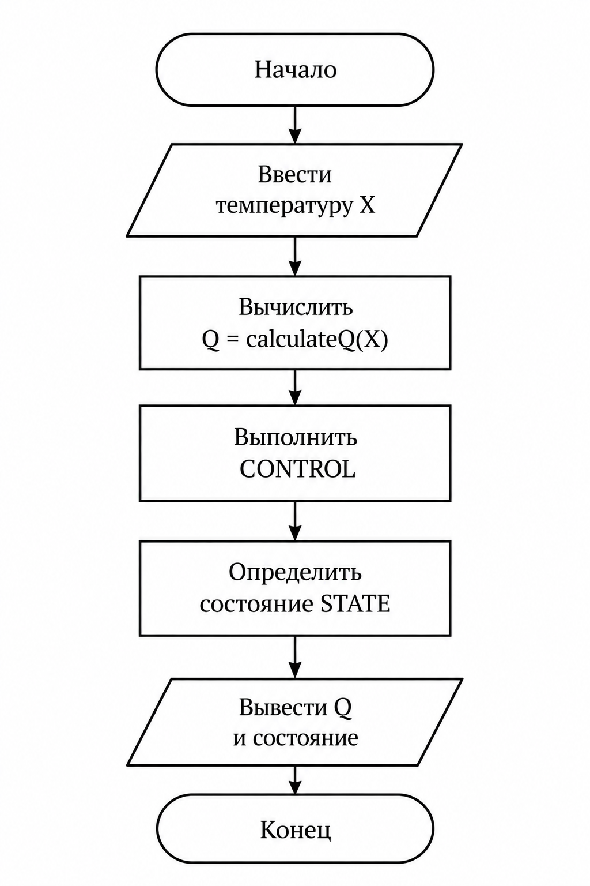
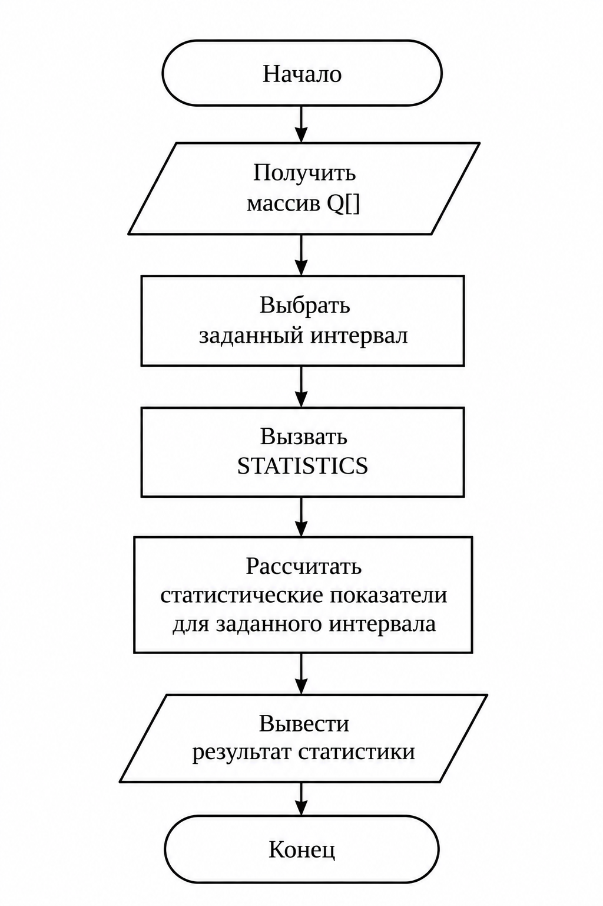

# Курсовой проект

## Вариант 1. Мониторинг реактора: температура реактора

### Постановка задачи

Необходимо разработать программу для преобразования показания датчика температуры реактора `X` в показатель технологического процесса `Q`.

Программа должна:

1. Получить значение температуры `X`.
2. Выполнить преобразование показания по заданной кусочной функции.
3. Получить значение `Q`.
4. Передать значение `Q` в блок оперативного контроля `CONTROL`.
5. Определить состояние процесса `STATE`.
6. Предусмотреть накопление значений `Q` для последующего статистического анализа `STATISTICS`.

На первом этапе КТ1 реализован расчёт `Q(X)`, а функции `CONTROL`, `STATE` и `STATISTICS` представлены в виде программного каркаса.

---

### Входные данные

`X` — показание датчика температуры реактора в градусах Цельсия.

Допустимый диапазон значений:

$$
60 \le X \le 100
$$

---

### Преобразование показания

Показание датчика преобразуется по кусочной функции:

$$
Q(X) =
\begin{cases}
2(X - 72) + 10, & X < 72 \\
\dfrac{(X - 80)^2}{3} + 45, & 72 \le X \le 88 \\
3\sqrt{X - 88 + 1} + 55, & X > 88
\end{cases}
$$

---

### Структура программы

Программа разделена на отдельные функции.

```c
double readTemperature(void);
```

Функция предназначена для чтения входного значения температуры `X`.

```c
double calculateQ(double x);
```

Функция выполняет преобразование показания датчика и возвращает значение `Q`.

```c
int control(double q);
```

Функция-заглушка блока оперативного контроля `CONTROL`.

```c
void printState(int state);
```

Функция-заглушка для вывода состояния технологического процесса `STATE`.

```c
void calculateStatistics(const double q[], int n);
```

Функция-заглушка для дальнейшего статистического анализа массива значений `Q`.

---

## Блок-схемы

### Преобразование и оперативный контроль

Цепочка обработки данных:

`X → calculateQ(X) → Q → CONTROL → STATE`



### Статистический анализ

Накопленные значения `Q` передаются на обработку статистической функции:

`Q[] → заданный интервал → STATISTICS`



---

## Ручные тесты

Для проверки работы функции `calculateQ()` используются значения из всех трёх диапазонов кусочной функции.

### Тест 1. Нижняя ветвь

Пусть:

$$
X = 65
$$

Так как:

$$
65 < 72
$$

используется первая формула:

$$
Q = 2(65 - 72) + 10
$$

$$
Q = 2(-7) + 10
$$

$$
Q = -14 + 10
$$

$$
Q = -4
$$

Результат:

```text
X = 65
Q = -4.00
```

---

### Тест 2. Средняя ветвь

Пусть:

$$
X = 80
$$

Так как:

$$
72 \le 80 \le 88
$$

используется вторая формула:

$$
Q = \frac{(80 - 80)^2}{3} + 45
$$

$$
Q = \frac{0}{3} + 45
$$

$$
Q = 45
$$

Результат:

```text
X = 80
Q = 45.00
```

---

### Тест 3. Верхняя ветвь

Пусть:

$$
X = 95
$$

Так как:

$$
95 > 88
$$

используется третья формула:

$$
Q = 3\sqrt{95 - 88 + 1} + 55
$$

$$
Q = 3\sqrt{8} + 55
$$

$$
Q \approx 63.49
$$

Результат:

```text
X = 95
Q = 63.49
```

---

## Контрольный пример

Для значения:

$$
X = 72
$$

используется средняя ветвь:

$$
Q = \frac{(72 - 80)^2}{3} + 45
$$

$$
Q = \frac{64}{3} + 45
$$

$$
Q \approx 66.33
$$

Результат:

```text
X = 72
Q = 66.33
```

---

## Исходный код

Исходный код программы находится в файле:

`main.c`

На этапе КТ1 полностью реализована функция преобразования `calculateQ()`.

Функции `CONTROL`, `STATE` и `STATISTICS` добавлены в виде программного каркаса и будут реализованы на следующих этапах проекта.
