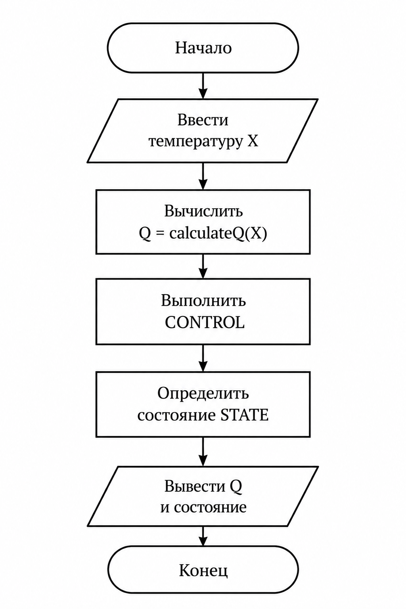

# Курсовой проект

## Вариант 1. Мониторинг реактора: температура реактора

### Постановка задачи

Разработать программу на языке C для мониторинга температуры реактора.

Программа выполняет:
1. Чтение показаний температуры X из файла `input.txt`.
2. Проверку допустимого диапазона температуры.
3. Преобразование X в показатель Q.
4. Оперативный контроль изменения Q.
5. Определение состояния технологического процесса.
6. Накопление результатов измерений.
7. Статистический анализ значений Q.

## Входные данные

- X — температура реактора, °C.
- Допустимый диапазон: 60 ≤ X ≤ 100.
- Количество измерений: N = 50.
- Нормальный температурный диапазон: 72–88 °C.

Исходные значения находятся в файле `input.txt`, по одному числу в строке.

## Преобразование показаний

Показатель Q рассчитывается по кусочной функции:

- При X < 72: `Q = 2 * (X - 72) + 10`
- При 72 ≤ X ≤ 88: `Q = (X - 80)^2 / 3 + 45`
- При X > 88: `Q = 3 * sqrt(X - 88 + 1) + 55`

Контрольный пример:

X = 72 → Q = 66.33

## Оперативный контроль

Базовое значение Q0 = 45.00.

Допустимое изменение между соседними показаниями:

`ΔQmax = 7`

Программа определяет три состояния:

- НОРМА — температура находится в штатном диапазоне, резкого изменения Q нет.
- ПРЕДУПРЕЖДЕНИЕ — температура вышла за штатный диапазон, но резкого изменения Q нет.
- ТРЕВОГА — модуль разности соседних значений Q превышает 7.

Приоритет имеет состояние ТРЕВОГА.

Для первого измерения сравнение с предыдущим значением не выполняется.

## КТ3. Статистический анализ

Для массива рассчитанных значений Q выполняется статистический анализ интервала `Q[6..17]`.

В программе используются индексы языка C, начиная с нуля.

Количество элементов интервала: 12.

Вычисляются:

1. Среднее арифметическое.
2. Минимальное значение.
3. Максимальное значение.
4. Размах.

Формулы:

`Qср = ΣQ[i] / 12`

`Qmin = min(Q[i])`

`Qmax = max(Q[i])`

`R = Qmax - Qmin`

Если обработано менее 18 измерений, программа сообщает о недостаточном количестве данных.

## Блок-схемы

### Преобразование Q(X)


### Оперативный контроль



### Статистический анализ КТ3


## Структура программы

`main.c` — исходный код программы.

`input.txt` — входные показания температуры.

`README.md` — описание курсового проекта.

Основные функции:

- `calculateQ(double x)` — расчёт показателя Q.
- `control(double x, double q)` — определение состояния.
- `printState(int state)` — вывод состояния.
- `calculateStatistics(const double q[], int n)` — статистический анализ.

## Проверка КТ3

При использовании тестового набора из 50 измерений получены следующие результаты:

| Показатель | Значение |
|---|---:|
| Количество измерений | 50 |
| Интервал | Q[6..17] |
| Количество элементов | 12 |
| Среднее | 52.85 |
| Минимум | 6.00 |
| Максимум | 66.33 |
| Размах | 60.33 |

Результаты совпадают с контрольным расчётом.

## Компиляция и запуск

На macOS:

```bash
clang main.c -o reactor -lm
./reactor
```

Файл `input.txt` должен находиться в рабочей папке программы.

## Результат

На этапе КТ3 реализованы чтение данных из файла, преобразование показаний, оперативный контроль и статистический анализ заданного интервала.

Программа успешно обработала 50 тестовых измерений.
