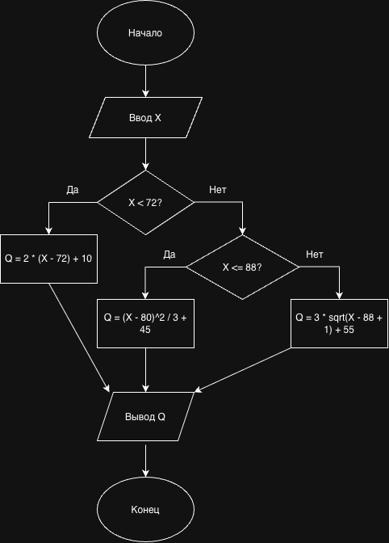

# Курсовой проект

## Вариант 1. Мониторинг реактора: температура реактора

### Постановка задачи

Необходимо разработать программу для преобразования показания датчика температуры реактора X в показатель технологического процесса Q.

Диапазон температуры:

60 ≤ X ≤ 100 °C

Преобразование выполняется по кусочной функции:

Q(X) =

- 2·(X − 72) + 10, при X < 72
- (X − 80)² / 3 + 45, при 72 ≤ X ≤ 88
- 3·√(X − 88 + 1) + 55, при X > 88

Программа должна:

1. Получить значение температуры X.
2. Определить, к какому диапазону относится значение X.
3. Вычислить Q по соответствующей формуле.
4. Вывести полученный результат.

### Контрольный пример

При:

X = 72 °C

результат:

Q = 66.33

## Блок-схема

## Программа

Исходный код программы находится в файле `main.c`.
