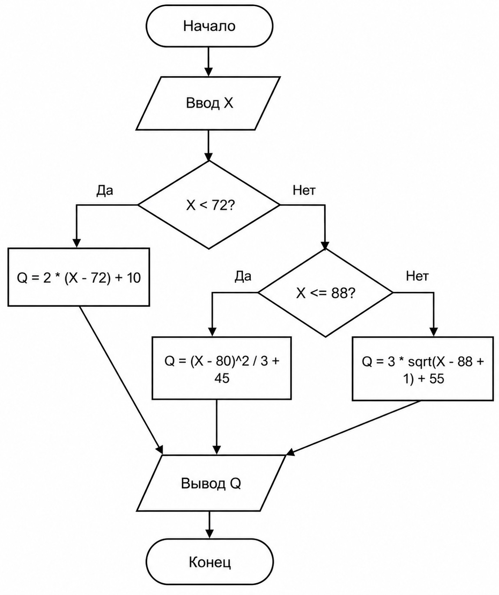
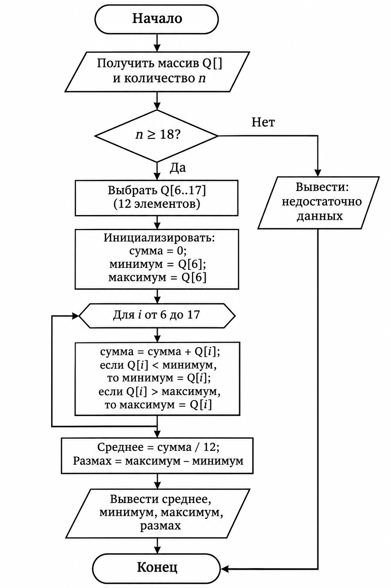

# Курсовой проект

## Вариант 1. Мониторинг реактора: температура реактора

### Постановка задачи

Разработать программу на языке C для мониторинга температуры реактора.

Программа выполняет:

1. Чтение показаний температуры X из файла `input.txt`.
2. Проверку допустимого диапазона температуры.
3. Преобразование X в показатель Q.
4. Оперативный контроль изменения Q.
5. Определение состояния технологического процесса.
6. Накопление результатов измерений.
7. Статистический анализ значений Q.
8. Управление настройками программы через консольное меню.
9. Обработку ошибок входных данных.

## Входные данные

- X — температура реактора, °C.
- Допустимый диапазон: 60–100 °C.
- Количество измерений: N = 50.
- Нормальный температурный диапазон: 72–88 °C.

Исходные значения находятся в файле `input.txt`, по одному числу в строке.

## Преобразование показаний

Показатель Q рассчитывается по кусочной функции:

$$
Q(X)=
\begin{cases}
2(X-72)+10, & 60\leq X<72,\\
\dfrac{(X-80)^2}{3}+45, & 72\leq X\leq88,\\
3\sqrt{X-88+1}+55, & 88<X\leq100.
\end{cases}
$$

Область допустимых значений:

$$
60\leq X\leq100
$$

### Ручные расчёты

#### Пример 1. X = 65 °C

Используется первая ветвь функции, поскольку X < 72.

$$
Q(65)=2(65-72)+10
$$

$$
Q(65)=2\cdot(-7)+10=-4
$$

Ответ: Q = -4.00.

#### Пример 2. X = 80 °C

Используется вторая ветвь функции, поскольку 72 ≤ X ≤ 88.

$$
Q(80)=\frac{(80-80)^2}{3}+45
$$

$$
Q(80)=\frac{0}{3}+45=45
$$

Ответ: Q = 45.00.

#### Пример 3. X = 95 °C

Используется третья ветвь функции, поскольку X > 88.

$$
Q(95)=3\sqrt{95-88+1}+55
$$

$$
Q(95)=3\sqrt{8}+55
$$

$$
Q(95)\approx63.49
$$

Ответ: Q = 63.49.

### Контрольный пример индивидуального задания

При X = 72 °C:

$$
Q(72)=\frac{(72-80)^2}{3}+45
$$

$$
Q(72)=\frac{64}{3}+45\approx66.33
$$

Полученное значение совпадает с контрольным примером индивидуального задания.

## Оперативный контроль

Базовое значение:

$$
Q_0=45.00
$$

Допустимое изменение между соседними показаниями:

$$
\Delta Q_{\max}=7
$$

Изменение показателя между соседними измерениями:

$$
\Delta Q_i=|Q_i-Q_{i-1}|
$$

Условие сигнализации:

$$
|Q_i-Q_{i-1}|>\Delta Q_{\max}
$$

Программа определяет три состояния:

- НОРМА — температура находится в штатном диапазоне, резкого изменения Q нет.
- ПРЕДУПРЕЖДЕНИЕ — температура вышла за штатный диапазон, но резкого изменения Q нет.
- ТРЕВОГА — модуль разности соседних значений Q превышает установленный порог.

Приоритет имеет состояние ТРЕВОГА.

Для первого измерения в текущей реализации сравнение с предыдущим значением не выполняется.

Использование FIFO индивидуальным вариантом не предусмотрено.

## Статистический анализ

Для массива рассчитанных значений Q выполняется статистический анализ интервала `Q[6..17]`.

В программе используются индексы языка C, начиная с нуля.

Количество элементов интервала:

$$
n=17-6+1=12
$$

### Среднее арифметическое

$$
Q_{\text{avg}}=\frac{1}{12}\sum_{i=6}^{17}Q_i
$$

### Минимальное значение

$$
Q_{\min}=\min_{6\leq i\leq17}Q_i
$$

### Максимальное значение

$$
Q_{\max}=\max_{6\leq i\leq17}Q_i
$$

### Размах

$$
R=Q_{\max}-Q_{\min}
$$

Если обработано менее 18 корректных измерений, программа сообщает о недостаточном количестве данных.

## КТ3. Чтение файла и потоковая обработка

Программа последовательно обрабатывает измерения из входного файла.

Для каждого измерения выполняются следующие действия:

1. Чтение значения X.
2. Проверка корректности записи.
3. Проверка допустимого диапазона X.
4. Вычисление показателя Q.
5. Оперативный контроль.
6. Вывод результата и состояния.
7. Сохранение необходимых данных для статистики.
8. Переход к следующему измерению.

Обработка продолжается до достижения конца файла.

Некорректные записи пропускаются с выводом сообщения об ошибке.

Предусмотрена обработка следующих ситуаций:

- Ошибка открытия файла.
- Некорректная запись.
- Выход температуры за допустимый диапазон.
- Пустой файл.
- Ошибка чтения файла.
- Достижение конца файла.

## Пользовательский интерфейс

Управление программой осуществляется через консольное меню:

```text
1. Обработать файл измерений
2. Изменить имя входного файла
3. Изменить порог сигнализации
4. Показать текущие настройки
0. Выход
```

По умолчанию используется файл `input.txt` и порог сигнализации 7.

При повторной обработке файла состояние предыдущего измерения сбрасывается.

## Блок-схемы

### Преобразование Q(X)



### Оперативный контроль


### Статистический анализ



## Структура проекта

| Файл | Назначение |
|---|---|
| `main.c` | Исходный код программы |
| `input.txt` | Основной файл из 50 измерений |
| `test.txt` | Проверочный файл |
| `empty.txt` | Проверка обработки пустого файла |
| `README.md` | Описание курсового проекта |

## Основные функции программы

### calculateQ

`double calculateQ(double x);`

Входные данные: температура x.

Возвращаемое значение: рассчитанный показатель Q.

### control

`int control(double x, double q, double previousQ, int first, double dqMax);`

Входные данные:

- x — текущая температура.
- q — текущий показатель Q.
- previousQ — предыдущий показатель Q.
- first — признак первого измерения.
- dqMax — допустимое изменение Q.

Возвращаемое значение:

- 0 — НОРМА.
- 1 — ПРЕДУПРЕЖДЕНИЕ.
- 2 — ТРЕВОГА.

### printState

`void printState(int state);`

Выводит название состояния технологического процесса.

### processFile

`void processFile(const char filename[], double dqMax);`

Выполняет последовательное чтение и обработку измерений из указанного файла.

### calculateStatistics

`void calculateStatistics(const double q[], int n);`

Вычисляет среднее арифметическое, минимум, максимум и размах заданного интервала массива Q.

## Проверка программы

### Основной файл input.txt

Ожидаемые результаты статистического анализа для 50 измерений:

| Показатель | Значение |
|---|---:|
| Количество измерений | 50 |
| Интервал | Q[6..17] |
| Количество элементов | 12 |
| Среднее | 52.85 |
| Минимум | 6.00 |
| Максимум | 66.33 |
| Размах | 60.33 |

### Проверочный файл test.txt

Ожидаемые результаты при пороге сигнализации 7:

| X | Q | Состояние |
|---:|---:|---|
| 80 | 45.00 | НОРМА |
| 81 | 45.33 | НОРМА |
| 88 | 66.33 | ТРЕВОГА |
| 90 | 60.20 | ПРЕДУПРЕЖДЕНИЕ |
| 70 | 6.00 | ТРЕВОГА |
| abc | — | Некорректная запись |
| 105 | — | Выход за диапазон |

Ожидаемое количество корректных измерений — 5.

Ожидаемое количество ошибочных записей — 2.

### Проверка пустого файла

При обработке файла `empty.txt` ожидается сообщение:

```text
Файл пуст
```

## Компиляция и запуск

На macOS:

```bash
clang -std=c99 main.c -o reactor -lm
./reactor
```

Входные файлы должны находиться в рабочей папке программы.

## Результат

Реализованы преобразование показаний температуры, оперативный контроль, статистический анализ, потоковая обработка файла, пользовательский интерфейс и обработка ошибок.

Для проверки подготовлены основной, тестовый и пустой входные файлы.
